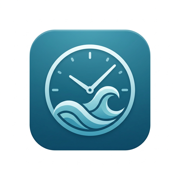

# OffGridDoc

[](https://github.com/Etherdancer/offgriddoc/actions/workflows/ci.yml)
[](https://offgriddoc.pages.dev/)
[](LICENSE)

**Redact PDFs and images in your browser — nothing is uploaded.**
OffGridDoc is an installable, offline-capable web app for blacking out personal information
in documents. Rendering, OCR, redaction and export all run on your device.



## Features

- **Multi-page PDFs and images** (JPEG, PNG, WebP, GIF, BMP) with page navigation.
- **Three redaction tools:** freehand brush, line, and resizable box (confirm with ✓ / Enter).
- **Auto-redact** phone numbers, e-mails, dates, long ID numbers, and labelled personal
  fields (name, address, nationality, place of birth, sex…) in ~30 languages. Text PDFs use
  their embedded text; scanned PDFs and images use on-device OCR (Tesseract).
- **Safe export:** every page is re-rasterised, so hidden text layers, form fields and
  metadata from the original are gone. Export all pages to PDF, or the current page to PNG/JPEG.
  An unconfirmed box is applied automatically before export.
- **EXIF stripping** for JPEG uploads (GPS, camera, timestamps).
- **Undo/redo** (Ctrl+Z / Ctrl+Y) per page.
- **Installable PWA** that works offline after the first visit.

## Privacy and network use

Documents are never sent anywhere. The app itself, the PDF engine, the OCR engine and the
**English** OCR model are served from this site and cached for offline use. The OCR models for
**other languages** (1–15 MB each) are downloaded from
[jsDelivr](https://www.jsdelivr.com/package/npm/@tesseract.js-data) the first time you pick
that language, then cached in your browser — only the model is downloaded; your document is not.

## Limitations

- Redaction is raster-based: exported PDFs contain images, so text is no longer selectable.
- Auto-redact is a heuristic. **Always review the result before sharing.**
- PDFs render at 1.5× (~108 dpi); very small print may need manual boxes.

## Development

Requires Node.js 20+.

```bash
npm install
npm run dev       # http://localhost:5173
npm run lint      # oxlint
npm run build     # type-check + production build in dist/
npm run preview   # serve the production build
```

### Project layout

| Path | What it is |
| --- | --- |
| `src/App.tsx` | Toolbar, file picker, export and OCR-language controls |
| `src/components/DocumentViewer.tsx` | Canvas rendering, pages, redaction tools, undo, auto-redact, export |
| `src/ocr.ts` | Self-hosted Tesseract worker setup |
| `vite.config.ts` | Build, PWA/service worker, copying the OCR engine into `dist/tesseract/` |
| `public/` | Static pages (privacy, terms, about) and icons |

Deployed on Cloudflare Pages from `master`.

## License

[MIT](LICENSE) © Etherdancer
